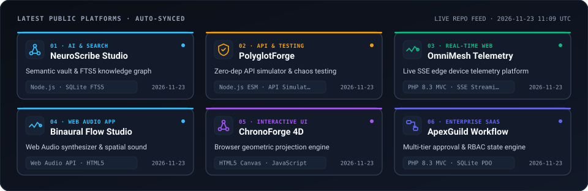

  <picture>
    <source media="(prefers-color-scheme: dark)" srcset="assets/hero-dark.svg" />
    <source media="(prefers-color-scheme: light)" srcset="assets/hero-light.svg" />
    
  </picture>

  <a href="mailto:pushpikaodisha.contact@gmail.com"><strong>Contact ↗</strong></a>
  &nbsp; · &nbsp;
  <a href="https://github.com/pushpikaodisha?tab=repositories"><strong>Repositories ↗</strong></a>
  &nbsp; · &nbsp;
  <a href="#engineering-workflow"><strong>Workflow</strong></a>
  &nbsp; · &nbsp;
  <a href="#featured-platforms"><strong>Platforms</strong></a>
  &nbsp; · &nbsp;
  <a href="#technology-matrix"><strong>Tech Stack</strong></a>
  &nbsp; · &nbsp;
  <a href="#github-observatory"><strong>Metrics</strong></a>

---

### About

I'm **Pushpika Odisha**, a Software Engineer from **Sri Lanka** specializing in **modern web applications, backend software architecture, and practical AI-integrated systems**. I focus on clean modular design, strong API contracts, real-time data delivery, and dependable security boundaries without unnecessary bloat.

---

### Engineering Workflow

  <picture>
    <source media="(prefers-color-scheme: dark)" srcset="assets/lifecycle-dark.svg" />
    <source media="(prefers-color-scheme: light)" srcset="assets/lifecycle-light.svg" />
    
  </picture>

---

### Featured Platforms

  <picture>
    <source media="(prefers-color-scheme: dark)" srcset="assets/projects-dark.svg" />
    <source media="(prefers-color-scheme: light)" srcset="assets/projects-light.svg" />
    
  </picture>

<!-- PROJECTS:START -->
<table>
  <tr>
    <td width="50%" valign="top">
      <h4>01 · <a href="https://github.com/pushpikaodisha/chronoledger-vault">ChronoLedger Vault ↗</a></h4>
      
Tamper-evident document notary and cryptographic audit system implementing RFC 6962 Merkle Tree verification proofs.

      
<code>Node.js</code> <code>RFC 6962 Merkle</code> <code>0 NPM Deps</code>

      

        
<b>Architecture &amp; Details</b> · Updated 2026-11-26

         
        <ul>
          <li><b>Cryptography:</b> RFC 6962 Merkle Tree inclusion &amp; consistency proofs</li>
          <li><b>Footprint:</b> Zero external NPM dependencies on Node.js 22</li>
          <li><b>Use Case:</b> Verifiable audit trails for critical records</li>
        </ul>
      

    </td>
    <td width="50%" valign="top">
      <h4>02 · <a href="https://github.com/pushpikaodisha/chronoforge-4d">ChronoForge 4D ↗</a></h4>
      
Browser-based 3D/4D geometric projection engine with responsive touch and mobile sensor controls.

      
<code>HTML5 Canvas</code> <code>JavaScript</code> <code>Geometry</code>

      

        
<b>Architecture &amp; Details</b> · Updated 2026-11-26

         
        <ul>
          <li><b>Rendering:</b> Smooth HTML5 Canvas 2D/3D real-time projection</li>
          <li><b>Input:</b> Desktop controls &amp; mobile gyroscope integration</li>
        </ul>
      

    </td>
  </tr>
  <tr>
    <td width="50%" valign="top">
      <h4>03 · <a href="https://github.com/pushpikaodisha/bioswarm-genesis">BioSwarm Genesis ↗</a></h4>
      
Real-time 60 FPS browser simulation driven by lightweight neural-perceptron agents in Vanilla ES6+.

      
<code>JavaScript ES6+</code> <code>HTML5 Canvas</code> <code>AI Agents</code>

      

        
<b>Architecture &amp; Details</b> · Updated 2026-11-26

         
        <ul>
          <li><b>Simulation:</b> 60 FPS HTML5 Canvas agent ecosystem loop</li>
          <li><b>AI Logic:</b> Lightweight neural-perceptron decision engine</li>
        </ul>
      

    </td>
    <td width="50%" valign="top">
      <h4>04 · <a href="https://github.com/pushpikaodisha/binaural-flow-studio">Binaural Flow Studio ↗</a></h4>
      
Interactive browser audio synthesizer and spatial sound visualization app powered by the Web Audio API.

      
<code>Web Audio API</code> <code>HTML5</code> <code>JavaScript</code>

      

        
<b>Architecture &amp; Details</b> · Updated 2026-11-26

         
        <ul>
          <li><b>Audio Engine:</b> Real-time browser synthesis using Web Audio API</li>
          <li><b>Spatial:</b> HRTF 3D binaural panning &amp; acoustic visualization</li>
        </ul>
      

    </td>
  </tr>
  <tr>
    <td width="50%" valign="top">
      <h4>05 · <a href="https://github.com/pushpikaodisha/apexguild-workflow">ApexGuild Workflow ↗</a></h4>
      
Enterprise multi-tier approval and state-machine web platform enforcing strict transition invariants and granular RBAC.

      
<code>PHP 8.3 MVC</code> <code>SQLite PDO</code> <code>RBAC</code>

      

        
<b>Architecture &amp; Details</b> · Updated 2026-11-26

         
        <ul>
          <li><b>Backend:</b> PHP 8.3 strict OOP/MVC service architecture</li>
          <li><b>Security:</b> Role-based access control &amp; guarded state transitions</li>
          <li><b>Persistence:</b> Parameterized SQLite PDO storage layer</li>
        </ul>
      

    </td>
    <td width="50%" valign="top">
      <h4>06 · <a href="https://github.com/pushpikaodisha/typescript-notes">Typescript Notes ↗</a></h4>
      
Type-safe modular TypeScript notes workspace with JSON/Markdown export, JSON import, and theme toggle.

      
<code>TypeScript</code> <code>GitHub</code>

      

        
<b>Architecture &amp; Details</b> · Updated 2026-11-26

         
        <ul>
          <li><b>Repository:</b> <code>typescript-notes</code></li>
          <li><b>Primary Language:</b> TypeScript</li>
          <li><b>Last Updated:</b> 2026-11-26</li>
        </ul>
      

    </td>
  </tr>
</table>
<!-- PROJECTS:END -->

  
<b>How Featured Platforms Auto-Sync</b>

   
  

    Every 30 minutes (and via <code>repository_dispatch</code>), <a href="scripts/generate_profile_assets.py"><code>scripts/generate_profile_assets.py</code></a> queries the GitHub API for newly published or updated public repositories (prioritizing pinned or <code>featured</code>-tagged repos, then latest pushed projects) and updates both <code>assets/projects-*.svg</code> and the table above automatically.
  

---

### Technology Matrix

  <picture>
    <source media="(prefers-color-scheme: dark)" srcset="assets/stack-dark.svg" />
    <source media="(prefers-color-scheme: light)" srcset="assets/stack-light.svg" />
    
  </picture>

<!-- SKILLS:START -->

  
<b>Complete Languages &amp; Technology Inventory</b> (Editable via <code>skills.json</code> + Auto-Detected)

   
  <table>
    <tr>
      <td><b>Languages</b></td>
      <td><code>JavaScript (ES6+)</code> <code>PHP 8.3</code> <code>Python</code> <code>HTML5</code> <code>CSS3</code> <code>SQL</code> <code>TypeScript</code></td>
    </tr>
    <tr>
      <td><b>Web &amp; Frontend</b></td>
      <td><code>Responsive UI</code> <code>SSE Streaming</code> <code>HTML5 Canvas</code> <code>Web Audio API</code> <code>Browser Web APIs</code> <code>Adaptive Theming</code></td>
    </tr>
    <tr>
      <td><b>Backend &amp; Software</b></td>
      <td><code>Node.js (ESM)</code> <code>PHP OOP / MVC</code> <code>RESTful APIs</code> <code>State Machines</code> <code>RBAC Security</code> <code>Modular Design</code></td>
    </tr>
    <tr>
      <td><b>AI &amp; Knowledge</b></td>
      <td><code>LLM APIs</code> <code>Prompt Eng.</code> <code>SQLite FTS5</code> <code>Knowledge Graphs</code> <code>Workflow Agents</code> <code>Semantic Search</code></td>
    </tr>
    <tr>
      <td><b>Data &amp; Integrity</b></td>
      <td><code>SQLite PDO</code> <code>Data Modeling</code> <code>Query Tuning</code> <code>RFC 6962 Merkle</code> <code>Audit Logging</code> <code>Data Integrity</code></td>
    </tr>
    <tr>
      <td><b>DevOps &amp; Testing</b></td>
      <td><code>GitHub Actions</code> <code>Chaos Testing</code> <code>Zero-Dep Design</code> <code>Automated CI</code> <code>API Contracts</code> <code>Linux &amp; CLI</code></td>
    </tr>
  </table>

<!-- SKILLS:END -->

---

### GitHub Observatory

  <picture>
    <source media="(prefers-color-scheme: dark)" srcset="assets/dashboard-dark.svg" />
    <source media="(prefers-color-scheme: light)" srcset="assets/dashboard-light.svg" />
    
  </picture>

---

### Connect

| Channel | Contact |
| :--- | :--- |
| **Email** | [pushpikaodisha.contact@gmail.com](mailto:pushpikaodisha.contact@gmail.com) |
| **GitHub** | [@pushpikaodisha](https://github.com/pushpikaodisha) |

  <a href="mailto:pushpikaodisha.contact@gmail.com">
    <picture>
      <source media="(prefers-color-scheme: dark)" srcset="assets/footer-dark.svg" />
      <source media="(prefers-color-scheme: light)" srcset="assets/footer-light.svg" />
      
    </picture>
  </a>

