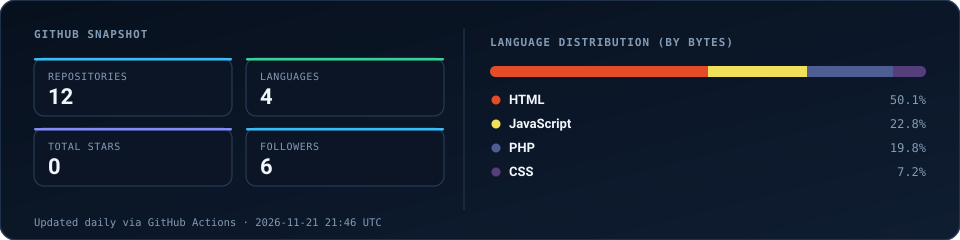

  <picture>
    <source media="(prefers-color-scheme: dark) and (max-width: 600px)" srcset="assets/hero-dark-mobile.svg" />
    <source media="(prefers-color-scheme: dark)" srcset="assets/hero-dark.svg" />
    <source media="(prefers-color-scheme: light) and (max-width: 600px)" srcset="assets/hero-light-mobile.svg" />
    <source media="(prefers-color-scheme: light)" srcset="assets/hero-light.svg" />
    
  </picture>

  <a href="mailto:pushpikaodisha.dev@gmail.com"><strong>Email ↗</strong></a>
  &nbsp; · &nbsp;
  <a href="https://github.com/pushpikaodisha?tab=repositories"><strong>Repositories ↗</strong></a>
  &nbsp; · &nbsp;
  <a href="https://github.com/pushpikaodisha?tab=stars"><strong>Starred ↗</strong></a>

  
    <a href="#about">About</a> &nbsp;/&nbsp;
    <a href="#selected-systems">Selected Systems</a> &nbsp;/&nbsp;
    <a href="#engineering-stack">Stack</a> &nbsp;/&nbsp;
    <a href="#github-metrics">Metrics</a> &nbsp;/&nbsp;
    <a href="#connect">Connect</a>
  

---

## About

I'm **Pushpika Odisha**, a software engineer based in **Sri Lanka** focused on building **self-contained, low-overhead software systems** — spanning zero-dependency Node.js engines, strict OOP/MVC PHP 8 platforms, cryptographic verification tools, and real-time browser simulations.

| At a glance | Focus |
| :--- | :--- |
| **Engineering Focus** | Backend architecture, API reliability, and deterministic data workflows |
| **Systems Philosophy** | Minimal external dependencies, clean modular boundaries, and clear observability |
| **Interactive Labs** | Canvas 2D/3D rendering, Web Audio synthesis, and physics/neural simulations |
| **Location** | Sri Lanka |

---

## Selected Systems

<table>
  <tr>
    <td width="50%" valign="top">
      <h4>01 · <a href="https://github.com/pushpikaodisha/neuroscribe-vault">NeuroScribe Studio</a></h4>
      
Knowledge graph vault and semantic Markdown research workspace featuring full-text search indexing and force-directed graph visualization.

      
<code>Node.js 22</code> <code>SQLite FTS5</code> <code>Graph Physics</code>

    </td>
    <td width="50%" valign="top">
      <h4>02 · <a href="https://github.com/pushpikaodisha/polyglot-forge">PolyglotForge</a></h4>
      
Zero-dependency API contract simulator and chaos engineering workbench built on pure Node.js ESM for fault-injection and resilience testing.

      
<code>Node.js ESM</code> <code>Chaos Testing</code> <code>Zero Dependencies</code>

    </td>
  </tr>
  <tr>
    <td width="50%" valign="top">
      <h4>03 · <a href="https://github.com/pushpikaodisha/omnimesh-telemetry">OmniMesh Telemetry</a></h4>
      
Distributed edge IoT and telemetry automation orchestrator implementing real-time Server-Sent Events (SSE) streaming over SQLite PDO.

      
<code>PHP 8.3 OOP/MVC</code> <code>SQLite PDO</code> <code>SSE Streaming</code>

    </td>
    <td width="50%" valign="top">
      <h4>04 · <a href="https://github.com/pushpikaodisha/apexguild-workflow">ApexGuild Workflow</a></h4>
      
Enterprise multi-tier approval and deterministic state-machine platform with granular role-based access control (RBAC).

      
<code>PHP 8.3 OOP/MVC</code> <code>State Machine</code> <code>RBAC Security</code>

    </td>
  </tr>
  <tr>
    <td width="50%" valign="top">
      <h4>05 · <a href="https://github.com/pushpikaodisha/chronoledger-vault">ChronoLedger Vault</a></h4>
      
Cryptographic document notary and tamper-evident audit verification system implementing RFC 6962 Merkle Trees with zero NPM dependencies.

      
<code>Node.js 22</code> <code>RFC 6962 Merkle</code> <code>Cryptography</code>

    </td>
    <td width="50%" valign="top">
      <h4>06 · <a href="https://github.com/pushpikaodisha/basic-website">Responsive Web &amp; UI Systems</a></h4>
      
Modern responsive web architecture featuring adaptive dark/light theming, modular CSS layouts, and accessible interactive components.

      
<code>HTML5</code> <code>CSS3</code> <code>JavaScript ES6+</code>

    </td>
  </tr>
</table>

  
<b>Interactive Graphics, Audio &amp; Simulation Labs (3 Projects)</b>

   
  <table>
    <tr>
      <th>Project</th>
      <th>Domain</th>
      <th>Highlights</th>
    </tr>
    <tr>
      <td><a href="https://github.com/pushpikaodisha/binaural-flow-studio"><b>Binaural Flow Studio</b></a></td>
      <td>Acoustic Synthesis</td>
      <td>Web Audio API synthesizer, HRTF 3D spatial audio, and Chladni cymatics visualization</td>
    </tr>
    <tr>
      <td><a href="https://github.com/pushpikaodisha/chronoforge-4d"><b>ChronoForge 4D</b></a></td>
      <td>Hyper-Geometry</td>
      <td>Non-Euclidean 4D tesseract projection engine on HTML5 Canvas with mobile gyroscope input</td>
    </tr>
    <tr>
      <td><a href="https://github.com/pushpikaodisha/bioswarm-genesis"><b>BioSwarm Genesis</b></a></td>
      <td>Artificial Life</td>
      <td>60 FPS neural-perceptron artificial life ecosystem simulation in Vanilla ES6+</td>
    </tr>
  </table>

---

## Engineering Stack

| Layer | Technologies & Patterns |
| :--- | :--- |
| **Backend & Runtimes** | Node.js (ESM), PHP 8.3 (OOP / MVC), REST APIs, Server-Sent Events (SSE) |
| **Frontend & Graphics** | JavaScript (ES6+), HTML5 Canvas 2D/3D, Web Audio API, Responsive CSS |
| **Data & Integrity** | SQLite (PDO / FTS5), Relational Modeling, Merkle Tree Verification |
| **Engineering Practices** | Zero-Dependency Architecture, Chaos Testing, RBAC, State Machines, Git & GitHub Actions |

---

## GitHub Metrics

  <picture>
    <source media="(prefers-color-scheme: dark) and (max-width: 600px)" srcset="assets/stats-dark-mobile.svg" />
    <source media="(prefers-color-scheme: dark)" srcset="assets/stats-dark.svg" />
    <source media="(prefers-color-scheme: light) and (max-width: 600px)" srcset="assets/stats-light-mobile.svg" />
    <source media="(prefers-color-scheme: light)" srcset="assets/stats-light.svg" />
    
  </picture>

  
<b>Architecture note:</b> How this profile works

   
  All visual cards in <code>assets/</code> are generated via <a href="scripts/generate_profile_assets.py"><code>scripts/generate_profile_assets.py</code></a> and refreshed daily through <a href=".github/workflows/update-profile.yml">GitHub Actions</a>. Each card renders dedicated Dark/Light and Desktop/Mobile SVG variants using native <code>&lt;picture&gt;</code> media queries.

---

## Connect

| Channel | Handle / Link |
| :--- | :--- |
| **Email** | [pushpikaodisha.dev@gmail.com](mailto:pushpikaodisha.dev@gmail.com) |
| **GitHub** | [@pushpikaodisha](https://github.com/pushpikaodisha) |

  <a href="mailto:pushpikaodisha.dev@gmail.com">
    <picture>
      <source media="(prefers-color-scheme: dark)" srcset="assets/footer-dark.svg" />
      <source media="(prefers-color-scheme: light)" srcset="assets/footer-light.svg" />
      
    </picture>
  </a>

