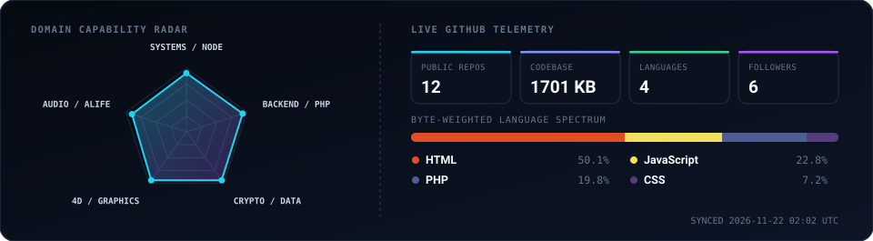
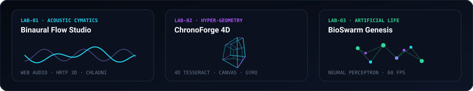

  <picture>
    <source media="(prefers-color-scheme: dark)" srcset="assets/hero-dark.svg" />
    <source media="(prefers-color-scheme: light)" srcset="assets/hero-light.svg" />
    
  </picture>

  <a href="mailto:pushpikaodisha.contact@gmail.com"><strong>Contact ↗</strong></a>
  &nbsp; · &nbsp;
  <a href="https://github.com/pushpikaodisha?tab=repositories"><strong>Repositories ↗</strong></a>
  &nbsp; · &nbsp;
  <a href="#systems-registry"><strong>Systems Dossier</strong></a>
  &nbsp; · &nbsp;
  <a href="#engineering-observatory"><strong>Observatory</strong></a>
  &nbsp; · &nbsp;
  <a href="#interactive-labs"><strong>Simulation Labs</strong></a>

---

### Engineering Thesis

I build **self-contained, low-overhead software systems** — prioritizing zero-dependency execution, cryptographic verifiability, and mathematical precision over bloated abstractions.

| Pillar | Implementation Focus |
| :--- | :--- |
| **Zero-Dependency Engines** | Pure Node.js ESM runtimes, custom chaos testing workbenches, and raw browser APIs |
| **Deterministic Backends** | PHP 8.3 OOP/MVC platforms, strict state machines, granular RBAC, and SSE streaming |
| **Verifiable Data** | RFC 6962 Merkle Tree document proofs, SQLite FTS5 indexing, and PDO persistence |
| **Interactive Computing** | Non-Euclidean 4D projections, HRTF 3D spatial audio, and 60 FPS artificial life |

---

### Systems Registry

<table>
  <tr>
    <td width="50%" valign="top">
      
<code>SYS-01</code> · <code>KNOWLEDGE ENGINE</code>

      <h4><a href="https://github.com/pushpikaodisha/neuroscribe-vault">NeuroScribe Studio</a></h4>
      
Semantic Markdown research workspace and knowledge graph vault powered by SQLite FTS5 indexing and force-directed graph physics.

      
<code>Node.js 22</code> <code>SQLite FTS5</code> <code>Force Graph</code>

    </td>
    <td width="50%" valign="top">
      
<code>SYS-02</code> · <code>RESILIENCE WORKBENCH</code>

      <h4><a href="https://github.com/pushpikaodisha/polyglot-forge">PolyglotForge</a></h4>
      
Zero-dependency API contract simulator and chaos engineering engine built in pure Node.js ESM for deterministic fault injection.

      
<code>Node.js ESM</code> <code>Chaos Testing</code> <code>0 NPM Deps</code>

    </td>
  </tr>
  <tr>
    <td width="50%" valign="top">
      
<code>SYS-03</code> · <code>EDGE TELEMETRY</code>

      <h4><a href="https://github.com/pushpikaodisha/omnimesh-telemetry">OmniMesh Telemetry</a></h4>
      
Distributed edge IoT orchestration platform streaming real-time device telemetry over Server-Sent Events (SSE) with SQLite PDO.

      
<code>PHP 8.3 OOP/MVC</code> <code>SQLite PDO</code> <code>SSE</code>

    </td>
    <td width="50%" valign="top">
      
<code>SYS-04</code> · <code>WORKFLOW ENGINE</code>

      <h4><a href="https://github.com/pushpikaodisha/apexguild-workflow">ApexGuild Workflow</a></h4>
      
Enterprise multi-tier approval and state-machine platform enforcing strict transition invariants and role-based access control.

      
<code>PHP 8.3 OOP/MVC</code> <code>State Machine</code> <code>RBAC</code>

    </td>
  </tr>
  <tr>
    <td width="50%" valign="top">
      
<code>SYS-05</code> · <code>CRYPTOGRAPHIC AUDIT</code>

      <h4><a href="https://github.com/pushpikaodisha/chronoledger-vault">ChronoLedger Vault</a></h4>
      
Tamper-evident document notary and cryptographic audit ledger implementing RFC 6962 Merkle Trees with zero external dependencies.

      
<code>Node.js 22</code> <code>RFC 6962 Merkle</code> <code>0 NPM Deps</code>

    </td>
    <td width="50%" valign="top">
      
<code>SYS-06</code> · <code>INTERFACE ARCHITECTURE</code>

      <h4><a href="https://github.com/pushpikaodisha/basic-website">Responsive Web Systems</a></h4>
      
Lightweight adaptive web architecture featuring zero-framework dark/light theming, modular CSS layouts, and accessible UI state.

      
<code>HTML5</code> <code>CSS3</code> <code>JavaScript ES6+</code>

    </td>
  </tr>
</table>

---

### Engineering Observatory

  <picture>
    <source media="(prefers-color-scheme: dark)" srcset="assets/telemetry-dark.svg" />
    <source media="(prefers-color-scheme: light)" srcset="assets/telemetry-light.svg" />
    
  </picture>

---

### Interactive Labs

  <picture>
    <source media="(prefers-color-scheme: dark)" srcset="assets/labs-dark.svg" />
    <source media="(prefers-color-scheme: light)" srcset="assets/labs-light.svg" />
    
  </picture>

  <a href="https://github.com/pushpikaodisha/binaural-flow-studio"><strong>LAB-01 · Binaural Flow Studio ↗</strong></a>
  &nbsp; · &nbsp;
  <a href="https://github.com/pushpikaodisha/chronoforge-4d"><strong>LAB-02 · ChronoForge 4D ↗</strong></a>
  &nbsp; · &nbsp;
  <a href="https://github.com/pushpikaodisha/bioswarm-genesis"><strong>LAB-03 · BioSwarm Genesis ↗</strong></a>

---

  <a href="mailto:pushpikaodisha.contact@gmail.com">
    <picture>
      <source media="(prefers-color-scheme: dark)" srcset="assets/footer-dark.svg" />
      <source media="(prefers-color-scheme: light)" srcset="assets/footer-light.svg" />
      
    </picture>
  </a>

