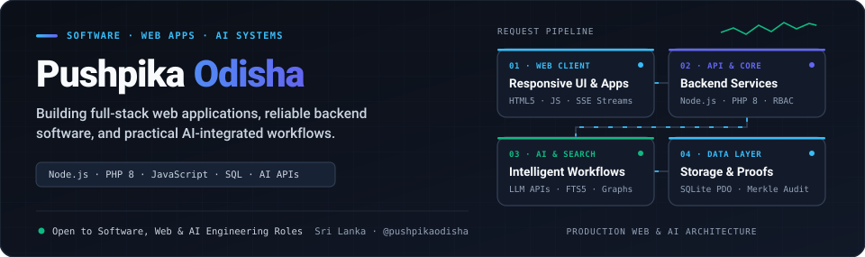
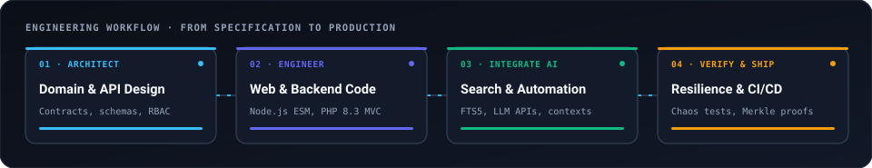
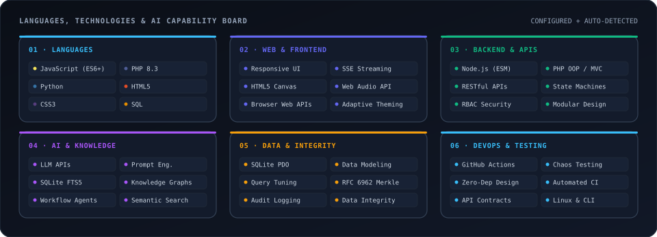

  <picture>
    <source media="(prefers-color-scheme: dark)" srcset="assets/hero-dark.svg" />
    <source media="(prefers-color-scheme: light)" srcset="assets/hero-light.svg" />
    
  </picture>

  <a href="mailto:pushpikaodisha.contact@gmail.com"><strong>Contact ↗</strong></a>
  &nbsp; · &nbsp;
  <a href="https://github.com/pushpikaodisha?tab=repositories"><strong>Repositories ↗</strong></a>
  &nbsp; · &nbsp;
  <a href="#engineering-workflow"><strong>Workflow</strong></a>
  &nbsp; · &nbsp;
  <a href="#featured-platforms"><strong>Platforms</strong></a>
  &nbsp; · &nbsp;
  <a href="#technology-matrix"><strong>Tech Stack</strong></a>
  &nbsp; · &nbsp;
  <a href="#github-observatory"><strong>Metrics</strong></a>

---

### About

I'm **Pushpika Odisha**, a Software Engineer from **Sri Lanka** specializing in **modern web applications, backend software architecture, and practical AI-integrated systems**. I focus on clean modular design, strong API contracts, real-time data delivery, and dependable security boundaries without unnecessary bloat.

---

### Engineering Workflow

  <picture>
    <source media="(prefers-color-scheme: dark)" srcset="assets/lifecycle-dark.svg" />
    <source media="(prefers-color-scheme: light)" srcset="assets/lifecycle-light.svg" />
    
  </picture>

---

### Featured Platforms

  <picture>
    <source media="(prefers-color-scheme: dark)" srcset="assets/projects-dark.svg" />
    <source media="(prefers-color-scheme: light)" srcset="assets/projects-light.svg" />
    
  </picture>

<table>
  <tr>
    <td width="50%" valign="top">
      <h4>01 · <a href="https://github.com/pushpikaodisha/neuroscribe-vault">NeuroScribe Studio ↗</a></h4>
      
Semantic Markdown knowledge vault and research workspace with SQLite FTS5 indexing and interactive graph exploration.

      

        
<b>Architecture Deep-Dive</b>

         
        <ul>
          <li><b>Core:</b> Node.js 22 runtime with zero external search bloat</li>
          <li><b>Indexing:</b> SQLite FTS5 full-text semantic query engine</li>
          <li><b>Visualization:</b> Force-directed document link graph</li>
        </ul>
      

    </td>
    <td width="50%" valign="top">
      <h4>02 · <a href="https://github.com/pushpikaodisha/apexguild-workflow">ApexGuild Workflow ↗</a></h4>
      
Enterprise multi-tier approval and state-machine web platform enforcing strict transition invariants and granular RBAC.

      

        
<b>Architecture Deep-Dive</b>

         
        <ul>
          <li><b>Backend:</b> PHP 8.3 strict OOP/MVC service architecture</li>
          <li><b>Security:</b> Role-based access control &amp; guarded state transitions</li>
          <li><b>Persistence:</b> Parameterized SQLite PDO storage layer</li>
        </ul>
      

    </td>
  </tr>
  <tr>
    <td width="50%" valign="top">
      <h4>03 · <a href="https://github.com/pushpikaodisha/omnimesh-telemetry">OmniMesh Telemetry ↗</a></h4>
      
Distributed edge telemetry and automation web orchestrator streaming live device events via Server-Sent Events (SSE).

      

        
<b>Architecture Deep-Dive</b>

         
        <ul>
          <li><b>Streaming:</b> Real-time SSE push pipeline to web dashboards</li>
          <li><b>Automation:</b> Rule-driven edge event orchestration in PHP 8.3</li>
          <li><b>Storage:</b> Lightweight SQLite PDO event persistence</li>
        </ul>
      

    </td>
    <td width="50%" valign="top">
      <h4>04 · <a href="https://github.com/pushpikaodisha/polyglot-forge">PolyglotForge ↗</a></h4>
      
Zero-dependency API contract simulator and chaos engineering workbench built on pure Node.js ESM for resilience testing.

      

        
<b>Architecture Deep-Dive</b>

         
        <ul>
          <li><b>Runtime:</b> Pure Node.js 22 ESM with 0 NPM dependencies</li>
          <li><b>Resilience:</b> Deterministic fault injection &amp; latency simulation</li>
          <li><b>Purpose:</b> Validates API contract behavior under failure modes</li>
        </ul>
      

    </td>
  </tr>
  <tr>
    <td width="50%" valign="top">
      <h4>05 · <a href="https://github.com/pushpikaodisha/chronoledger-vault">ChronoLedger Vault ↗</a></h4>
      
Tamper-evident document notary and cryptographic audit system implementing RFC 6962 Merkle Tree verification proofs.

      

        
<b>Architecture Deep-Dive</b>

         
        <ul>
          <li><b>Cryptography:</b> RFC 6962 Merkle Tree inclusion &amp; consistency proofs</li>
          <li><b>Footprint:</b> Zero external NPM dependencies on Node.js 22</li>
          <li><b>Use Case:</b> Verifiable audit trails for critical records</li>
        </ul>
      

    </td>
    <td width="50%" valign="top">
      <h4>06 · <a href="https://github.com/pushpikaodisha/basic-website">Responsive Web Systems ↗</a></h4>
      
Modern responsive web application architecture with adaptive dark/light theming, modular CSS layouts, and accessible UI state.

      

        
<b>Architecture Deep-Dive</b>

         
        <ul>
          <li><b>Frontend:</b> Semantic HTML5, modular CSS3, Vanilla ES6+</li>
          <li><b>UX:</b> Adaptive Dark/Light theme switching &amp; mobile layout</li>
          <li><b>Performance:</b> Clean zero-framework bundle delivery</li>
        </ul>
      

    </td>
  </tr>
</table>

  
<b>Additional Interactive Browser &amp; Simulation Projects (3 Repositories)</b>

   
  <table>
    <tr>
      <th>Project</th>
      <th>Domain</th>
      <th>Highlights</th>
    </tr>
    <tr>
      <td><a href="https://github.com/pushpikaodisha/binaural-flow-studio"><b>Binaural Flow Studio</b></a></td>
      <td>Web Audio API</td>
      <td>Interactive browser audio synthesizer, HRTF 3D spatial sound &amp; cymatics visualization</td>
    </tr>
    <tr>
      <td><a href="https://github.com/pushpikaodisha/chronoforge-4d"><b>ChronoForge 4D</b></a></td>
      <td>Interactive Canvas</td>
      <td>Browser 3D/4D geometric projection engine with responsive touch &amp; gyroscope controls</td>
    </tr>
    <tr>
      <td><a href="https://github.com/pushpikaodisha/bioswarm-genesis"><b>BioSwarm Genesis</b></a></td>
      <td>Simulation Engine</td>
      <td>60 FPS browser simulation driven by lightweight neural-perceptron agents</td>
    </tr>
  </table>

---

### Technology Matrix

  <picture>
    <source media="(prefers-color-scheme: dark)" srcset="assets/stack-dark.svg" />
    <source media="(prefers-color-scheme: light)" srcset="assets/stack-light.svg" />
    
  </picture>

---

### GitHub Observatory

  <picture>
    <source media="(prefers-color-scheme: dark)" srcset="assets/dashboard-dark.svg" />
    <source media="(prefers-color-scheme: light)" srcset="assets/dashboard-light.svg" />
    
  </picture>

---

### Connect

| Channel | Contact |
| :--- | :--- |
| **Email** | [pushpikaodisha.contact@gmail.com](mailto:pushpikaodisha.contact@gmail.com) |
| **GitHub** | [@pushpikaodisha](https://github.com/pushpikaodisha) |

  <a href="mailto:pushpikaodisha.contact@gmail.com">
    <picture>
      <source media="(prefers-color-scheme: dark)" srcset="assets/footer-dark.svg" />
      <source media="(prefers-color-scheme: light)" srcset="assets/footer-light.svg" />
      
    </picture>
  </a>

