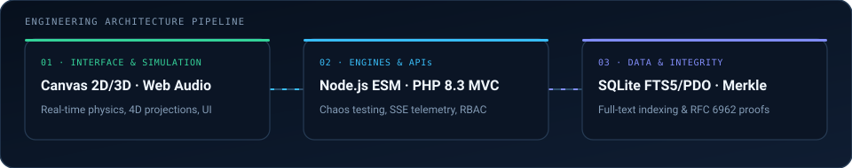

  <picture>
    <source media="(prefers-color-scheme: dark)" srcset="assets/hero-dark.svg" />
    <source media="(prefers-color-scheme: light)" srcset="assets/hero-light.svg" />
    
  </picture>

<h1 align="center">Hi, I'm Pushpika 👋</h1>

  <strong>Full-Stack &amp; Systems Software Engineer · Sri Lanka</strong> 
  Designing zero-dependency Node.js engines, strict OOP/MVC PHP platforms, 
  cryptographic tooling, and real-time interactive web simulations.

  <a href="mailto:pushpikaodisha.contact@gmail.com"><strong>Get in touch ↗</strong></a>
  &nbsp; · &nbsp;
  <a href="https://github.com/pushpikaodisha?tab=repositories"><strong>Explore repositories ↗</strong></a>
  &nbsp; · &nbsp;
  <a href="https://github.com/pushpikaodisha?tab=stars"><strong>Starred projects ↗</strong></a>

  
    <a href="#about">About</a> &nbsp;/&nbsp;
    <a href="#architecture">Architecture</a> &nbsp;/&nbsp;
    <a href="#selected-systems">Projects</a> &nbsp;/&nbsp;
    <a href="#engineering-stack">Stack</a> &nbsp;/&nbsp;
    <a href="#github-metrics">Metrics</a> &nbsp;/&nbsp;
    <a href="#connect">Contact</a>
  

---

## About

I'm **Pushpika Odisha**, a developer from **Sri Lanka** who builds **self-contained, deterministic software** without bloated dependency trees. My work spans from low-overhead backend engines and telemetry orchestrators to 4D hyper-geometry and acoustic synthesis in the browser.

| At a glance | Focus |
| :--- | :--- |
| **Engineering Focus** | Backend architecture, API resilience, and zero-dependency tooling |
| **Core Strengths** | Node.js ESM engines, PHP 8.3 OOP/MVC systems, SQLite FTS5/PDO, SSE streaming |
| **Security & Integrity** | RFC 6962 Merkle Tree proofs, granular RBAC, deterministic state machines |
| **Based in** | Sri Lanka |

---

## Architecture

  <picture>
    <source media="(prefers-color-scheme: dark)" srcset="assets/arch-dark.svg" />
    <source media="(prefers-color-scheme: light)" srcset="assets/arch-light.svg" />
    
  </picture>

---

## Selected Systems

<table>
  <tr>
    <td width="50%" valign="top">
      <h4>01 · <a href="https://github.com/pushpikaodisha/neuroscribe-vault">NeuroScribe Studio</a></h4>
      
Knowledge graph vault and semantic Markdown research workspace featuring full-text search indexing and force-directed graph visualization.

      
<code>Node.js 22</code> <code>SQLite FTS5</code> <code>Force-Directed Graph</code>

    </td>
    <td width="50%" valign="top">
      <h4>02 · <a href="https://github.com/pushpikaodisha/polyglot-forge">PolyglotForge</a></h4>
      
Zero-dependency API contract simulator and chaos engineering workbench built on pure Node.js ESM for fault-injection and resilience testing.

      
<code>Node.js ESM</code> <code>Chaos Engineering</code> <code>Zero NPM</code>

    </td>
  </tr>
  <tr>
    <td width="50%" valign="top">
      <h4>03 · <a href="https://github.com/pushpikaodisha/omnimesh-telemetry">OmniMesh Telemetry</a></h4>
      
Distributed edge IoT and telemetry automation orchestrator implementing real-time Server-Sent Events (SSE) streaming over SQLite PDO.

      
<code>PHP 8.3 OOP/MVC</code> <code>SQLite PDO</code> <code>SSE Streaming</code>

    </td>
    <td width="50%" valign="top">
      <h4>04 · <a href="https://github.com/pushpikaodisha/apexguild-workflow">ApexGuild Workflow</a></h4>
      
Enterprise multi-tier approval and deterministic state-machine platform with granular role-based access control (RBAC).

      
<code>PHP 8.3 OOP/MVC</code> <code>State Machine</code> <code>RBAC Security</code>

    </td>
  </tr>
  <tr>
    <td width="50%" valign="top">
      <h4>05 · <a href="https://github.com/pushpikaodisha/chronoledger-vault">ChronoLedger Vault</a></h4>
      
Cryptographic document notary and tamper-evident audit verification system implementing RFC 6962 Merkle Trees with zero NPM dependencies.

      
<code>Node.js 22</code> <code>RFC 6962 Merkle</code> <code>Cryptography</code>

    </td>
    <td width="50%" valign="top">
      <h4>06 · <a href="https://github.com/pushpikaodisha/basic-website">Responsive Web &amp; UI Systems</a></h4>
      
Modern responsive web architecture featuring adaptive dark/light theming, modular CSS layouts, and accessible interactive components.

      
<code>HTML5</code> <code>CSS3</code> <code>JavaScript ES6+</code>

    </td>
  </tr>
</table>

  
<b>Interactive Graphics, Audio &amp; Simulation Labs (3 Projects)</b>

   
  <table>
    <tr>
      <th>Project</th>
      <th>Domain</th>
      <th>Highlights</th>
    </tr>
    <tr>
      <td><a href="https://github.com/pushpikaodisha/binaural-flow-studio"><b>Binaural Flow Studio</b></a></td>
      <td>Acoustic Synthesis</td>
      <td>Web Audio API synthesizer, HRTF 3D spatial audio, and Chladni cymatics visualization</td>
    </tr>
    <tr>
      <td><a href="https://github.com/pushpikaodisha/chronoforge-4d"><b>ChronoForge 4D</b></a></td>
      <td>Hyper-Geometry</td>
      <td>Non-Euclidean 4D tesseract projection engine on HTML5 Canvas with mobile gyroscope input</td>
    </tr>
    <tr>
      <td><a href="https://github.com/pushpikaodisha/bioswarm-genesis"><b>BioSwarm Genesis</b></a></td>
      <td>Artificial Life</td>
      <td>60 FPS neural-perceptron artificial life ecosystem simulation in Vanilla ES6+</td>
    </tr>
  </table>

---

## Engineering Stack

| Layer | Technologies &amp; Patterns |
| :--- | :--- |
| **Backend &amp; Runtimes** | Node.js (ESM), PHP 8.3 (OOP / MVC), REST APIs, Server-Sent Events (SSE) |
| **Frontend &amp; Graphics** | JavaScript (ES6+), HTML5 Canvas 2D/3D, Web Audio API, Responsive CSS |
| **Data &amp; Integrity** | SQLite (PDO / FTS5), Relational Modeling, Merkle Tree Verification |
| **Practices &amp; Automation** | Zero-Dependency Design, Chaos Testing, RBAC, State Machines, GitHub Actions |

---

## GitHub Metrics

  <picture>
    <source media="(prefers-color-scheme: dark)" srcset="assets/stats-dark.svg" />
    <source media="(prefers-color-scheme: light)" srcset="assets/stats-light.svg" />
    
  </picture>

---

## Connect

| Channel | Handle / Link |
| :--- | :--- |
| **Email** | [pushpikaodisha.contact@gmail.com](mailto:pushpikaodisha.contact@gmail.com) |
| **GitHub** | [@pushpikaodisha](https://github.com/pushpikaodisha) |

  <a href="mailto:pushpikaodisha.contact@gmail.com">
    <picture>
      <source media="(prefers-color-scheme: dark)" srcset="assets/footer-dark.svg" />
      <source media="(prefers-color-scheme: light)" srcset="assets/footer-light.svg" />
      
    </picture>
  </a>

