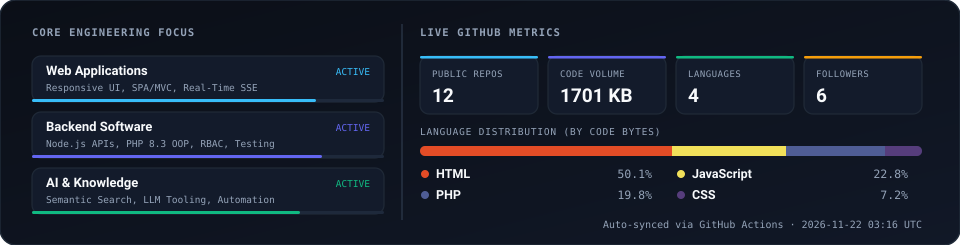

  <picture>
    <source media="(prefers-color-scheme: dark)" srcset="assets/hero-dark.svg" />
    <source media="(prefers-color-scheme: light)" srcset="assets/hero-light.svg" />
    
  </picture>

  <a href="mailto:pushpikaodisha.contact@gmail.com"><strong>Email ↗</strong></a>
  &nbsp; · &nbsp;
  <a href="https://github.com/pushpikaodisha?tab=repositories"><strong>Repositories ↗</strong></a>
  &nbsp; · &nbsp;
  <a href="#featured-software--web-platforms"><strong>Projects</strong></a>
  &nbsp; · &nbsp;
  <a href="#technology-stack"><strong>Tech Stack</strong></a>
  &nbsp; · &nbsp;
  <a href="#engineering-dashboard"><strong>Metrics</strong></a>
  &nbsp; · &nbsp;
  <a href="#connect"><strong>Contact</strong></a>

---

### About

I'm **Pushpika Odisha**, a Software Engineer from **Sri Lanka** focused on building **modern web applications, scalable backend software, and practical AI-integrated systems**. I design clean, maintainable architectures with strong API contracts, real-time data pipelines, and reliable security boundaries.

| Focus Area | Engineering Scope |
| :--- | :--- |
| **Web Applications** | Responsive multi-theme interfaces, interactive dashboards, real-time Server-Sent Events (SSE) |
| **Backend &amp; Software** | Node.js (ESM) services, PHP 8.3 OOP/MVC platforms, state machines, role-based access control |
| **AI &amp; Knowledge Systems** | Semantic full-text search (SQLite FTS5), knowledge graphs, LLM API integration &amp; automation |
| **Quality &amp; Security** | Contract testing, chaos/fault-injection workbenches, tamper-evident Merkle audit trails |

---

### Featured Software &amp; Web Platforms

<table>
  <tr>
    <td width="50%" valign="top">
      
<code>01 · KNOWLEDGE &amp; AI WORKSPACE</code>

      <h4><a href="https://github.com/pushpikaodisha/neuroscribe-vault">NeuroScribe Studio</a></h4>
      
Semantic Markdown knowledge vault and research web workspace featuring SQLite FTS5 full-text search indexing and interactive relationship graphs.

      
<code>Node.js</code> <code>SQLite FTS5</code> <code>Semantic Search</code>

    </td>
    <td width="50%" valign="top">
      
<code>02 · ENTERPRISE SAAS WORKFLOW</code>

      <h4><a href="https://github.com/pushpikaodisha/apexguild-workflow">ApexGuild Workflow</a></h4>
      
Enterprise multi-tier approval and workflow management web platform enforcing deterministic state transitions and granular RBAC permissions.

      
<code>PHP 8.3 MVC</code> <code>SQLite PDO</code> <code>RBAC</code>

    </td>
  </tr>
  <tr>
    <td width="50%" valign="top">
      
<code>03 · REAL-TIME WEB PLATFORM</code>

      <h4><a href="https://github.com/pushpikaodisha/omnimesh-telemetry">OmniMesh Telemetry</a></h4>
      
Distributed telemetry and automation web orchestrator streaming live device events to browser dashboards via Server-Sent Events (SSE).

      
<code>PHP 8.3 MVC</code> <code>SSE Streaming</code> <code>Automation</code>

    </td>
    <td width="50%" valign="top">
      
<code>04 · API &amp; TESTING SOFTWARE</code>

      <h4><a href="https://github.com/pushpikaodisha/polyglot-forge">PolyglotForge</a></h4>
      
API contract simulator and resilience testing workbench built on pure Node.js ESM to validate backend reliability under latency and fault scenarios.

      
<code>Node.js ESM</code> <code>API Simulation</code> <code>Testing</code>

    </td>
  </tr>
  <tr>
    <td width="50%" valign="top">
      
<code>05 · DOCUMENT SECURITY SOFTWARE</code>

      <h4><a href="https://github.com/pushpikaodisha/chronoledger-vault">ChronoLedger Vault</a></h4>
      
Tamper-evident document notary and cryptographic verification engine implementing RFC 6962 Merkle Tree proofs with zero external dependencies.

      
<code>Node.js</code> <code>Merkle Audit</code> <code>Verification</code>

    </td>
    <td width="50%" valign="top">
      
<code>06 · MODERN WEB ARCHITECTURE</code>

      <h4><a href="https://github.com/pushpikaodisha/basic-website">Responsive Web Systems</a></h4>
      
Clean, responsive web application architecture featuring adaptive dark/light theming, modular CSS layouts, and interactive UI components.

      
<code>HTML5</code> <code>CSS3</code> <code>JavaScript ES6+</code>

    </td>
  </tr>
</table>

  
<b>Additional Web &amp; Browser Engineering Projects</b>

   
  <table>
    <tr>
      <th>Project</th>
      <th>Focus</th>
      <th>Summary</th>
    </tr>
    <tr>
      <td><a href="https://github.com/pushpikaodisha/binaural-flow-studio"><b>Binaural Flow Studio</b></a></td>
      <td>Web Audio API</td>
      <td>Interactive browser audio synthesizer and spatial sound visualization app</td>
    </tr>
    <tr>
      <td><a href="https://github.com/pushpikaodisha/chronoforge-4d"><b>ChronoForge 4D</b></a></td>
      <td>Interactive Canvas</td>
      <td>Browser-based 3D/4D geometric projection engine with responsive touch &amp; sensor input</td>
    </tr>
    <tr>
      <td><a href="https://github.com/pushpikaodisha/bioswarm-genesis"><b>BioSwarm Genesis</b></a></td>
      <td>Simulation Engine</td>
      <td>Real-time 60 FPS browser simulation driven by lightweight neural-perceptron agents</td>
    </tr>
  </table>

---

### Technology Stack

| Layer | Technologies &amp; Capabilities |
| :--- | :--- |
| **Web &amp; Frontend** | JavaScript (ES6+), HTML5, CSS3, Responsive UI Architecture, Server-Sent Events (SSE), Web APIs |
| **Backend &amp; Software** | Node.js (ESM), PHP 8.3 (OOP / MVC), RESTful APIs, State Machines, Authentication &amp; RBAC |
| **AI &amp; Intelligent Systems** | LLM API Integration, Prompt &amp; Context Engineering, Semantic Search (FTS5), Workflow Automation |
| **Databases &amp; Data** | SQLite (PDO / FTS5), Relational Data Modeling, Audit Logging &amp; Integrity Proofs |
| **Tooling &amp; Workflow** | Git, GitHub Actions, Automated Testing, Zero-Dependency Software Design |

---

### Engineering Dashboard

  <picture>
    <source media="(prefers-color-scheme: dark)" srcset="assets/dashboard-dark.svg" />
    <source media="(prefers-color-scheme: light)" srcset="assets/dashboard-light.svg" />
    
  </picture>

---

### Connect

| Channel | Contact |
| :--- | :--- |
| **Email** | [pushpikaodisha.contact@gmail.com](mailto:pushpikaodisha.contact@gmail.com) |
| **GitHub** | [@pushpikaodisha](https://github.com/pushpikaodisha) |

  <a href="mailto:pushpikaodisha.contact@gmail.com">
    <picture>
      <source media="(prefers-color-scheme: dark)" srcset="assets/footer-dark.svg" />
      <source media="(prefers-color-scheme: light)" srcset="assets/footer-light.svg" />
      
    </picture>
  </a>

